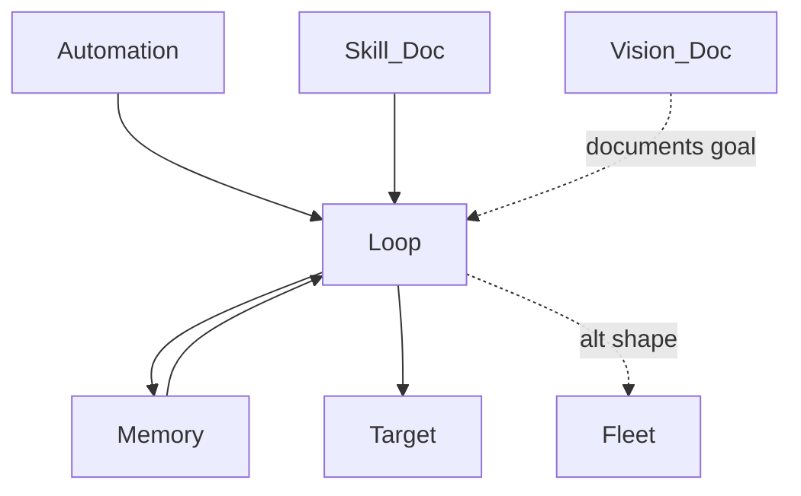

## 1. Stack
- Language: Python 3 (`loop.py`, `fleet.py`, `target/*.py`)
- Shell: Bash (`run_loop.sh`, cron entry inside per README)
- No package manifest found (no package.json/go.mod/pyproject.toml/Cargo.toml) — plain-script repo
- Docs-as-config: `RULES.md`, `SKILL.md`, `VISION.md` are read by the loop at runtime (per README)

## 2. Directory map
| path | what lives there |
|---|---|
| `/` | `README.md`, `RULES.md`, `SKILL.md`, `VISION.md`, `loop.py`, `fleet.py`, `run_loop.sh`, `.gitignore` |
| `target/` | `string_utils.py` (code under repair), `test_string_utils.py` (its test suite) |

## 3. Diagram

Note: nodes `Skill_Doc`/`Vision_Doc` map to root files `SKILL.md`/`VISION.md`; the
component note filenames are suffixed `_Doc` because this filesystem is
case-insensitive and `Skill.md`/`Vision.md` would collide with those files.

## 4. Component index
- [[Loop]]
- [[Fleet]]
- [[Automation]]
- [[Memory]]
- [[Skill_Doc]]
- [[Vision_Doc]]
- [[Target]]

## 5. Entry points
- Dev / manual: `python3 loop.py` — REPO_ROOT/loop.py (single-agent loop)
- Automation / heartbeat: `./run_loop.sh` — REPO_ROOT/run_loop.sh
- Fleet shape: `python3 fleet.py` — REPO_ROOT/fleet.py

## 6. Conventions
- Classes are PascalCase and split by responsibility: `SingleAgentLoop`, `Maker`, `Checker` (README poster-mapping table) — maker and checker are never the same agent.
- Functions are snake_case: `append_rule()`, `learned_rules()`, `notify()`, `gate()` (README).
- Proposed fixes are never written directly to the target file: a passing run leaves `target/string_utils.py` untouched and writes the fix to `.loop/proposed_fix.py` instead — merge is manual (README).
- Learned rules are appended to `RULES.md` below the marker line "the loop writes below this line"; deleting lines under that marker resets memory (README).
- The quality gate is deterministic (`Checker.gate()`: parse + lint + tests), not a note or a vibe check (README).

## 7. Where things go
- To change what's being repaired: edit `target/string_utils.py` and its assertions in `target/test_string_utils.py`.
- To seed or reset the loop's memory: edit `RULES.md` below the "the loop writes below this line" marker.
- To change what project knowledge the agent loads each run: edit `SKILL.md`.
- To scale from one agent to many: use `fleet.py` instead of `loop.py` (README section 4, "Single vs fleet").
- To change the automation schedule: edit the cron entry inside `run_loop.sh`.
