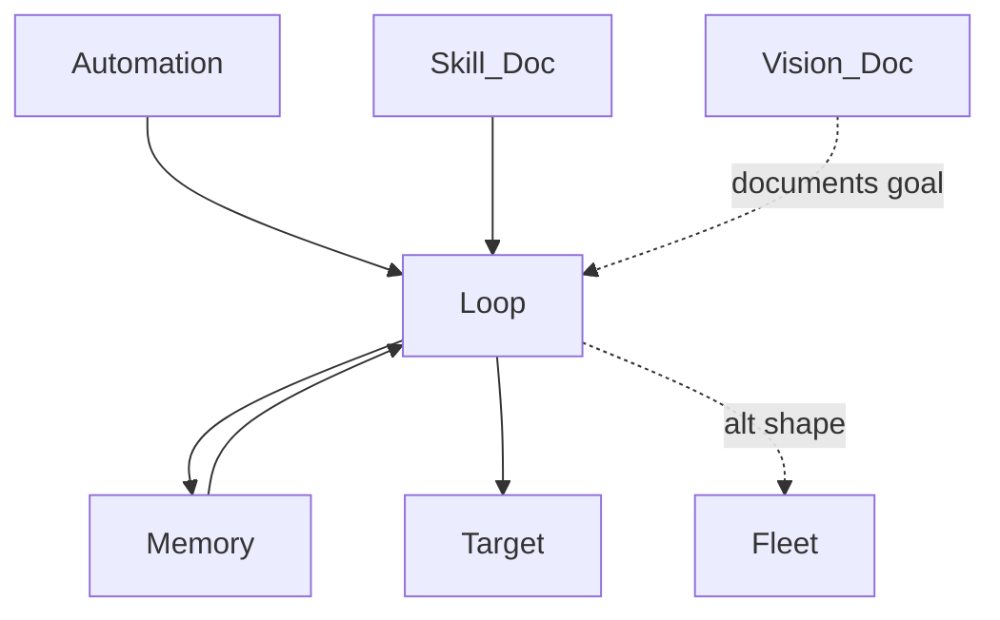

# sleep-loop — Loop Engineering 101, made runnable

A closed, self-learning loop that repairs a broken `slugify()` while you sleep,
learns from every failed attempt, and pings you to merge instead of shipping on
its own. `python3 loop.py` and watch it work.

## Architecture / How it Works




## What you just saw
- Run 1: failed 3 strategies, turned each into a permanent rule, passed on attempt 4.
- Run 2: recovered those 3 dead ends from `RULES.md` and passed on attempt 1.
- The loop you run tomorrow is sharper than today's. That's the whole point.

## How each concept from the poster shows up in the code

| Poster section | Where it lives |
|---|---|
| **1. The cycle** (discover→plan→execute→verify→iterate) | `SingleAgentLoop.run()` |
| **2. Closed loop** (fixed goal, auto validation, cheap to throw away) | `VISION.md` + throwaway worktrees |
| **3a. Automations** — heartbeat on a schedule | `run_loop.sh` (cron entry inside) |
| **3b. Worktrees** — isolated copy per attempt | `SingleAgentLoop._worktree()` |
| **3c. Skills** — project knowledge read every run | `SKILL.md`, loaded by `Maker` |
| **3d. Plugins/Connectors** — touches your real tools, pings you | `notify()` → `.loop/notifications.log` |
| **3e. Subagents** — maker and checker are never the same | `Maker` vs `Checker` |
| **3f. Memory** — lives outside the chat, never forgotten | `RULES.md` + `learned_rules()` |
| **4. Single vs fleet** | `SingleAgentLoop` (default) vs `fleet.py` |
| **5. Loop in practice** — load goal+rules, maker, checker, gate, learn | `loop.py` top to bottom |
| **6. Quality gate** — things the agent can't argue with | `Checker.gate()`: parse + lint + tests |
| **7. Self-learning** — every mistake becomes a permanent check | `append_rule()` + memory recovery in `__init__` |

## The one line that matters (section 5)
On failure: `append_rule(...)`. The loop proposes the fix and pings you; it never
merges to main. After a pass, the real `target/string_utils.py` is still untouched —
the proposed fix waits in `.loop/proposed_fix.py`. **The merge is yours.**

## Run it
```bash
python3 loop.py        # the single-agent loop
./run_loop.sh          # the same, via the automation entrypoint
python3 fleet.py       # the fleet shape (only if one agent isn't enough)
```

To reset the demo's memory and watch it re-learn from scratch, delete the lines
under `the loop writes below this line` in `RULES.md`.

## The DON'Ts and DO's from the poster, honored here
- ✅ builder (`Maker`) and reviewer (`Checker`) are split into two agents
- ✅ each attempt gets its own worktree
- ✅ the loop connects to your tools (`notify`) and learns (`RULES.md`)
- ❌ rules/memory are NOT trapped in the chat — they're on disk
- ❌ nothing runs by hand — `run_loop.sh` is the heartbeat
- ❌ the gate is deterministic checks, not a plain note or vibes
